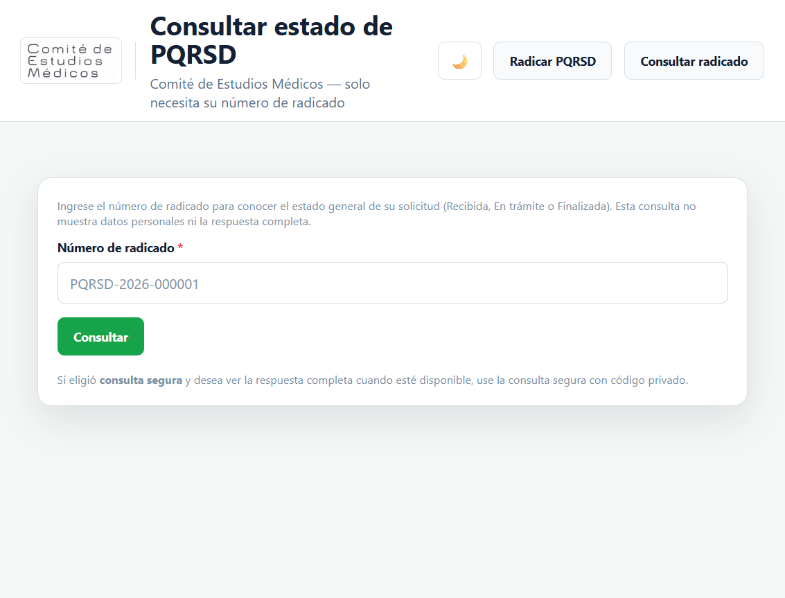
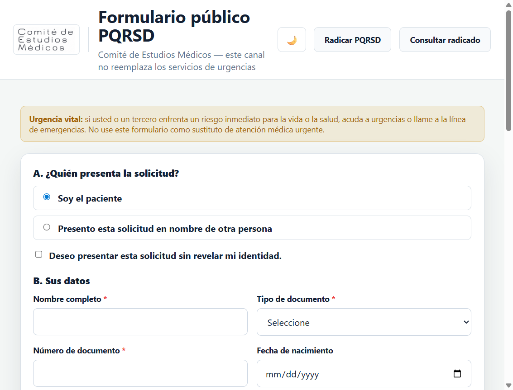
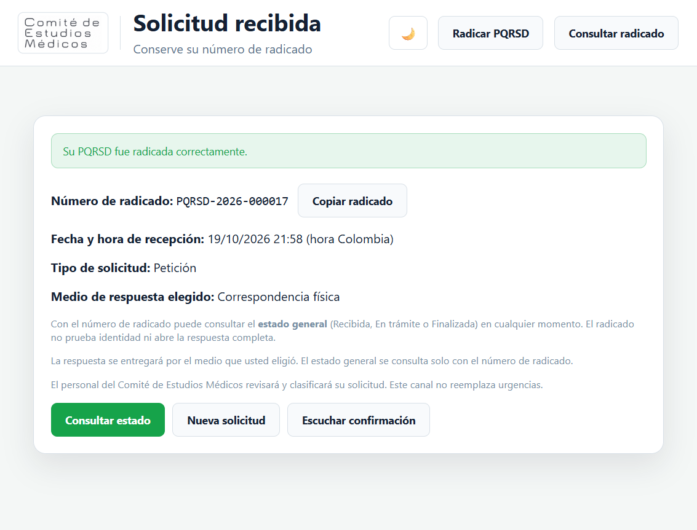

# Mejoras del formulario público, consulta y confirmación PQRSD

Comité de Estudios Médicos — canal ciudadano.

## Resumen

Se simplificó la experiencia pública sin cambiar SLA, meta del 95 %, clasificación, respuesta, cierre, logo ni integración Gmail:

1. Consulta de **estado general solo con radicado**.
2. Opciones claras **paciente / tercero** + anonimato independiente.
3. **Tipos de documento** en selector (catálogo normalizado).
4. **Medio de respuesta** como sección general.
5. Validaciones y mensajes en **español**.
6. **Sonido de confirmación** progresivo en la pantalla de éxito.
7. Confirmación sin exigir código privado para el estado general.

## Consulta por radicado

| Antes | Ahora |
|-------|--------|
| Radicado + código de consulta | Solo número de radicado |
| Podía mostrar más detalle con el token | Solo estado público mínimo |

Estados públicos (`App\Support\EstadoPublicoPqrsd`):

- **Recibida**
- **En trámite**
- **Finalizada**

Más un mensaje breve de seguimiento. No se muestran nombres, documentos, contactos, datos clínicos, motivos sensibles, respuestas completas ni adjuntos.

La **consulta segura** (`/publico/consulta-segura`) permanece como mecanismo separado: radicado + código privado para el texto de la respuesta cuando esté disponible. Los tokens históricos no se eliminan.

### Seguridad

- Rate limit por IP en consulta de estado (`config/pqrsd_publico.php` → `consulta_estado`).
- Rate limit en consulta segura.
- Rechazo de radicado/token en query string GET (redirección al formulario POST).
- El radicado no se trata como prueba de identidad.

## Paciente / tercero / anonimato

Selección excluyente:

- **Soy el paciente** — un solo bloque de identidad; se ocultan relación y datos duplicados del paciente; fecha de nacimiento una sola vez.
- **Presento esta solicitud en nombre de otra persona** — datos del solicitante, del paciente y relación.

Checkbox independiente:

- **Deseo presentar esta solicitud sin revelar mi identidad** — no exige identidad del solicitante cuando el anonimato está permitido; al alternar no se borran en silencio los valores ya diligenciados (solo se ocultan).

El backend valida según `quien_radica` y `es_anonimo`; campos ocultos por una elección válida no quedan obligatorios. Valores contradictorios por HTTP manipulado se normalizan o se rechazan.

## Tipos de documento

Catálogo en `config/pqrsd_publico.php` → `tipos_documento`:

CC, TI, RC, CE, PA, PPT.

Selectores en solicitante y paciente. Códigos normalizados; no se aceptan tipos inventados. Registros históricos siguen legibles.

## Medio de respuesta (sección general)

Sección **¿Cómo desea recibir o consultar la respuesta?** (después de identificar a quién corresponde la solicitud):

- Correo electrónico — correo obligatorio + autorización; sin afirmar envío automático Gmail.
- Correspondencia física — dirección obligatoria.
- Consulta segura en el portal — informa verificación para contenido privado.

Teléfono complementario: regex + mínimo de dígitos reales (rechaza `ASDFGHJKL`; acepta prefijos como `+57 …`). No es canal para información clínica sensible por SMS.

## Validaciones en español

- Locale `es` y `lang/es/validation.php`.
- Mensajes personalizados (medio, documento, teléfono, descripción, quién presenta).
- Campos con error marcados (`is-invalid` / `field-error`); se conservan valores válidos con `old()`.

## Sonido de confirmación

En `/publico/confirmacion`, tras radicación exitosa:

- Tono corto vía Web Audio API (sin dependencias externas).
- Un solo intento automático; botón **Escuchar confirmación** si el navegador bloquea audio.
- Fallos de audio no afectan la radicación ni el mensaje visual: **Su PQRSD fue radicada correctamente.**

## Pantalla «Solicitud recibida»

Conserva: radicado, fecha/hora, tipo, medio, Copiar radicado, Consultar estado, Nueva solicitud.

Código privado solo si el medio fue **consulta segura**. No se envían datos personales ni códigos en la URL.

## Capturas de navegador







## Archivos principales modificados / añadidos

| Archivo | Rol |
|---------|-----|
| `app/Http/Controllers/Publico/FormularioPublicoController.php` | Radicación, consulta estado, consulta segura |
| `app/Support/EstadoPublicoPqrsd.php` | Etiquetas/mensajes públicos |
| `config/pqrsd_publico.php` | Medios, documentos, rate limit consulta |
| `lang/es/validation.php` | Mensajes en español |
| `routes/web.php` | Rutas consulta / consulta-segura |
| `resources/views/publico/formulario.blade.php` | UX paciente/tercero/medio/docs |
| `resources/views/publico/consulta.blade.php` | Consulta solo radicado |
| `resources/views/publico/consulta-estado.blade.php` | Resultado público mínimo |
| `resources/views/publico/consulta-segura.blade.php` | Acceso privado |
| `resources/views/publico/confirmacion.blade.php` | Éxito + sonido |
| `tests/Feature/MejorasFormularioPublicoConsultaTest.php` | Cobertura nueva |
| Tests existentes de formulario/consulta | Ajustados a `quien_radica` y consulta por radicado |

## Pruebas ejecutadas (resultados reales)

Línea base previa reportada: 210 / 1.585 + 6 MySQL / 40.

Tras los cambios:

```text
php artisan test
→ passed — 228 tests, 1707 assertions

php artisan test -c phpunit.mysql-concurrency.xml
→ passed — 6 tests, 40 assertions
```

Cobertura nueva (`MejorasFormularioPublicoConsultaTest`, 16 pruebas): consulta solo radicado, privacidad, anti-enumeración/abuso, paciente, tercero, anónimo, campos ocultos, selectores documento, medios email/correspondencia/consulta segura, teléfono, mensajes ES, radicación e idempotencia, sonido no bloqueante, consulta privada conservada, viewport móvil.

## Restricciones respetadas

- Sin cambio de tiempos SLA ni meta 95 %.
- Sin alterar flujo de clasificación / respuesta / cierre.
- Sin Gmail API, OAuth ni Pub/Sub.
- Sin borrar datos históricos ni tokens de consulta.
- Sin exponer información sensible en la consulta pública.
- Logo del Comité sin modificar.
